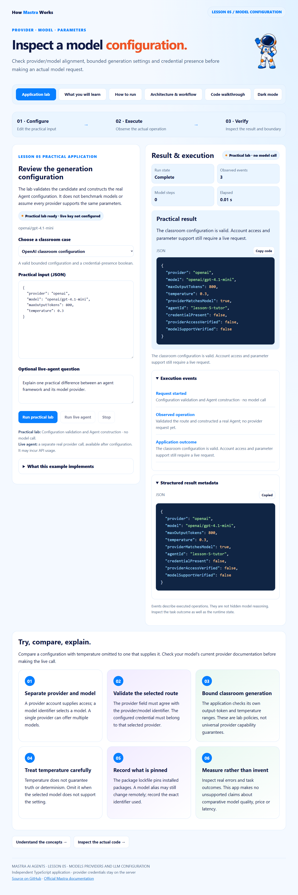

# Mastra · Lesson 05 · Models Providers and LLM Configuration

Check provider/model alignment, bounded generation settings and credential presence before making an actual model request.



## Start

Use Node.js 24+. This is an independent repository.

```powershell
git clone https://github.com/luiscoco/Udemy-Mastra-lesson05-app.git
cd Udemy-Mastra-lesson05-app
npm ci
npm start
```

Open http://127.0.0.1:3205. **Run practical lab** executes: Configuration validation and Agent construction · no model call. Starting the host makes no model call.

## Five student pages

Application lab · What you will learn · How to run · Architecture & workflow · Code walkthrough. They preserve the approved lesson 1 astronaut, typography, colors, light/dark theme, responsive layout, safe Markdown rendering, syntax colors and copy-code controls.

## Implemented exercise

The lab validates the candidate and constructs the real Agent configuration. It does not benchmark models or assume every provider supports the same parameters.

- **OpenAI classroom configuration:** A valid bounded configuration and a credential-presence boolean.
- **Provider/model mismatch:** A mismatch finding; no provider call is attempted.

Local validation makes zero model calls. It cannot prove account access or model-specific parameter support. The live path uses the selected configuration and is required to check those operational properties.

## Optional actual model run

Preserve any existing local configuration. No credential has been copied from another app.

```powershell
if (!(Test-Path .env)) { Copy-Item .env.example .env }
notepad .env
```

Enter your own provider key, choose a model your account can access, and restart. Keys stay on the server and are ignored by Git. Shell values take precedence over the optional file. Live generation may incur provider usage; the normal practical operation does not.

```dotenv
# Set your own provider credential locally. No credential is copied from another app.
OPENAI_API_KEY=your_api_key
MASTRA_MODEL=openai/gpt-4.1-mini
PORT=3205
# Optional, only for the provider you select:
ANTHROPIC_API_KEY=your_api_key
GOOGLE_GENERATIVE_AI_API_KEY=your_api_key
```

## Build and test

```powershell
npm run sample
npm run sample:live
npm run build
npm test
npm run test:browser
```

The normal sample executes the real key-free operation. The live sample requires provider configuration. Offline SDK integration tests use Mastra's explicit model-test adapter and do not make paid model calls. Browser tests execute the real local lab, navigate all five pages, check responsive behavior and safe code rendering, and capture this app's own preview. Set BROWSER_EXECUTABLE for a nonstandard Chrome/Chromium path.

Source-linked excerpts and the browser script are generated from the actual implementation. Rebuild after editing source. Generated public files and dependency lockfiles are committed for reproducibility.

## Student exercise

Compare a configuration with temperature omitted to one that supplies it. Check your model's current provider documentation before making the live call.

## Key source files

- [src/lab.ts](src/lab.ts)
- [src/mastra/index.ts](src/mastra/index.ts)
- [src/mastra/agents.ts](src/mastra/agents.ts)
- [Request host](src/server.ts)
- [Execution envelope](src/runner.ts)
- [Student page generator](scripts/build-pages.ts)

## References

- [Approved lesson 1 baseline](https://github.com/luiscoco/Udemy-Mastra-lesson01-app)
- [Model providers](https://mastra.ai/docs/models/overview)
- [Generation settings](https://mastra.ai/reference/agents/generate)

The astronaut, base styles and Prism integration follow the user's approved course assets. Prism's license remains in public/prism-LICENSE.txt. This application's lesson-specific operations, contracts, examples and explanations are tailored to Lesson 5.
